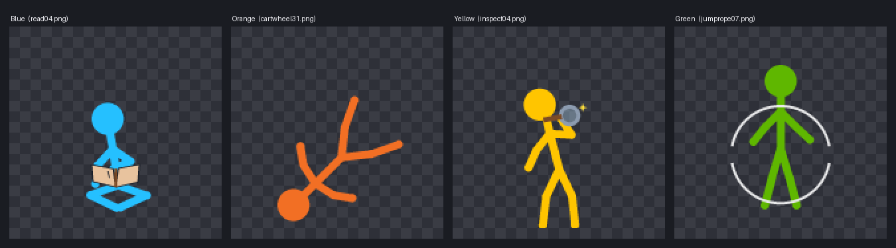
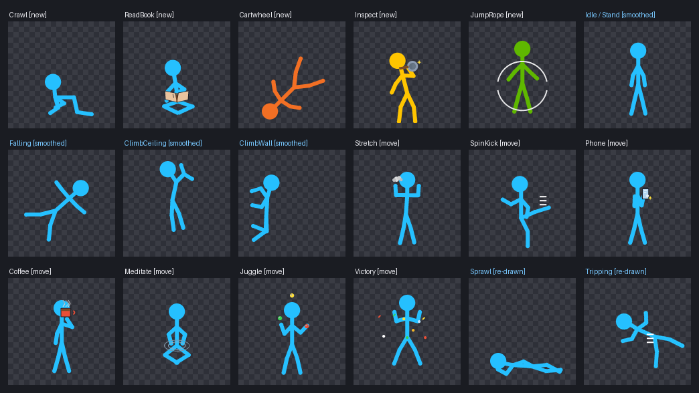
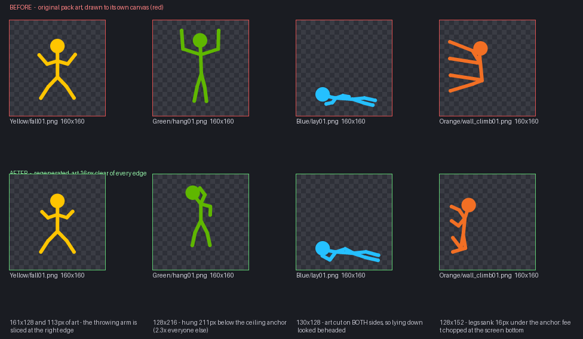
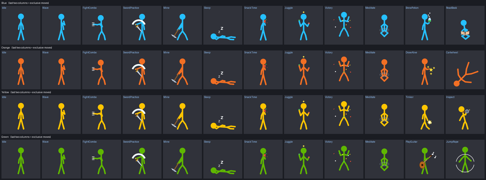

# Stick — AvA Shimeji 4-Pack (Blue / Orange / Yellow / Green)

Animation vs Animator style desktop buddies for **Shimeji-ee on Linux**, with a
batch of crisp animations generated in the pack's exact art style, plus first
class support for **Hyprland**.



Recently rebuilt:

* **16 new moves** and rebuilt crawl/fall cycles: falling, wall crawling and
  ceiling crawling now use 48-frame, 25 fps cycles, each character gets a different
  phase/tempo, and four new personality-exclusive moves keep the crew from
  replaying the same thing together (see [Animation](#animation)).
* **The frame generator can no longer produce a clipped frame.** Every
  generated frame is 160×160 with 16 px of clear space on every side, verified
  pixel by pixel on every run — so nothing pokes out of its window, ever.
* **No more cloning.** Shimeji-ee's breeding behaviour is switched off in the
  XML, in the installer and in `conf/settings.properties`: the crew stays at
  four.
* **Shijima-Qt path** (`linux/shijima.sh`) that repackages this same crew for
  the other runner and autostarts it, if that is what you already use.
* **Hyprland script** (`linux/hyprland.sh`) that stops the window boxes and
  makes the shimejis actually start with your session.

---

## Fedora + Hyprland: fix an existing installation

Run these **inside your Hyprland session, as your normal user (not sudo)**,
using the updated scripts. **Pick the runner you actually use — not both.**

**Shimeji-ee (Java):**

```bash
./linux/hyprland.sh ~/Shimeji-ee   # use your actual Shimeji-ee folder
```

This stops the old Java instances, repairs the **installed** no-cloning XML
and settings, installs/reloads the correct rules, and starts one fresh crew.
`--no-start` applies the repair but leaves them stopped. To install/update the
art as well, run `./linux/install.sh ~/Shimeji-ee`, then
`~/Shimeji-ee/ava-toggle.sh --start`.

**Shijima-Qt (native, Flatpak or AppImage): one box containing several moving stickmen**

First check **Shijima's own settings**, not Hyprland's rules:

1. Right-click a moving stickman → **Show manager**.
2. Under **Settings**, uncheck **Enable multiplication**. This changes the
   running app immediately; it does not remove copies already on screen.
3. Also uncheck **Windowed mode**. This mode puts all mascots inside a shared
   sandbox window. Removing a compositor border does **not** turn it into
   desktop mode.
4. Right-click a stickman → **Dismiss all** to clear the crowd. Use **Dismiss**,
   not **Edit → Delete shimeji** (which deletes an imported character).
5. In the manager, double-click **Blue**, **Orange**, **Yellow** and **Green**
   once each. Each double-click spawns another copy.

These steps work in the running app without installing updated scripts.
Windowed mode is a live checkbox in upstream Shijima-Qt: its HTTP API cannot
read or change it, and an invented `windowedMode=false` config key will not
fix it. If it is already unchecked and the shared box remains, capture a
screenshot and run `hyprctl configerrors` rather than reinstalling blindly.

For the pack/rules/autostart repair (native binary on PATH or Flatpak):

```bash
./linux/shijima.sh --install --autostart --restart
```

This restarts the host to discard old XML held in memory, replaces the four
installed mascots, turns off **Settings → Enable multiplication**, and puts
one of each on screen. Restarting the host clears its current screen; other
on-screen mascots are not automatically restored. Later runs of the session
helper remove only excess Blue/Orange/Yellow/Green copies, leaving other
mascots alone. Without `--restart`, quit Shijima-Qt before installing.

**The built-in Python runner (`runner/ava_runner.py`):** restart it after
updating (`systemctl --user restart ava-runner.service` if you installed its
service). It now uses XWayland and unmanaged sprite windows, rather than
Wayland application windows that Hyprland can frame/tile. Do not leave its
service running while using one of the other hosts.

Check for rejected rules after applying the fix:

```bash
hyprctl configerrors              # should be empty
./linux/hyprland.sh --check        # Java host diagnostics
# or: ./linux/shijima.sh --check
```

A reload alone cannot repair already-tiled windows or replace a host's cached
XML — the restart matters. Remove any old **hand-written** `exec`/`exec-once`
commands that launch another host or launch raw `java -jar`; use the guarded
`ava-toggle.sh --start` instead. The scripts update their own managed rules,
not unrelated entries in your config. If version detection is unavailable,
pass `--syntax v2` for Hyprland 0.30–0.52, `--syntax v3` for 0.53+ hyprlang,
or `--syntax lua` for a Lua config; they no longer silently guess.

## If you use Hyprland (or Wayland at all)

These symptoms have different causes; a border rule cannot fix all of them:

| What you see | What is actually happening | Fix |
|---|---|---|
| Several moving shimejis share one boxed area | Shijima-Qt may be in **Windowed mode**, which parents the mascots to a sandbox window. | Right-click → **Show manager** → **Settings** → uncheck **Windowed mode**. Disable **Enable multiplication** separately and dismiss the existing crowd. |
| Every shimeji sits in a highlighted box, and they get resized/rearranged | The sprite's X11 window is being managed like a normal application window. Invalid rules have the same effect as missing ones. | Version-correct floating, undecorated, no-shadow/no-blur/no-animation rules, followed by a host restart. |
| They come back as a crowd, or the wrong ones come back | Old breeding XML/settings, duplicate launches, or two different hosts running the pack. | Remove cloning actions/references in the installed pack, disable the host's multiplication setting, use a locked/idempotent launcher and only one host. |
| They never autostart, or start twice | Hyprland itself does not process XDG autostart, but a session manager such as UWSM can. Using both mechanisms with an unguarded launcher can duplicate the crew. | Hyprland `exec-once` (Lua: `hyprland.start`) with a guarded launcher; `NotShowIn=Hyprland;` on the XDG entry. |

```bash
./linux/install.sh          # installs the pack (runs the Hyprland step itself
                            # when it can tell you are on Hyprland)
./linux/hyprland.sh         # or run the Hyprland part on its own
./linux/hyprland.sh --check # show what Hyprland sees, right now
```

`hyprland.sh` detects your config and writes the right flavour of rules:

* `~/.config/hypr/hyprland.conf` — `windowrulev2` (≈0.30–0.52), the unified
  `windowrule = match:class ..., float on` form (0.53+, hyprlang), or the legacy
  `windowrule` form on very old builds. Auto-detected from `hyprctl version`,
  overridable with `--syntax v1|v2|v3`.
* `~/.config/hypr/hyprland.lua` — a Lua `hl.window_rule({...})` (0.55+).
* no config found — it prints a snippet to paste and leaves the mascots stopped.
* no Hyprland session/config — it repairs the installed Shimeji-ee settings
  without changing compositor rules.

Rule generation and settings repairs are idempotent; the first backups of
edited main configs and host settings are kept as `*.ava-bak`. Other image
sets are left alone. `--uninstall` removes the managed compositor includes
without discarding unrelated edits made since installation, and restores
backed-up host settings. The repaired pack itself stays installed.

Autostart uses `ava-toggle.sh --start`, not raw Java or a toggle. A lock
serializes concurrent start/stop requests, and process matching handles both
absolute and relative jar paths (including spaces). The XDG entry is excluded
from Hyprland but retained for GNOME/KDE. Both installers check
`hyprctl configerrors` after reload and refuse to start new sprites if the
configuration was rejected.

### Already running Shijima-Qt?

[Shijima-Qt](https://github.com/pixelomer/Shijima-Qt) is the other shimeji
runner for Linux, and the one this repo is usually used with. It was
[archived/discontinued](https://github.com/pixelomer/Shijima-Qt) in 2026
(Flathub marked it EOL), but it still works — and it can still use this pack,
including the fixed animations and the no-breeding setup, because it reads the
same XML schema.

What it cannot do by itself is autostart: Hyprland never reads
`~/.config/autostart`, and Shijima-Qt has no Hyprland integration, which is why
it never came back after a reboot. `linux/shijima.sh` fixes that:

```bash
./linux/shijima.sh --install --autostart --restart
```

It repackages each character into the `<Name>.mascot` folder (and `.mascot.zip`
archive) Shijima-Qt's import dialog expects, copies them into Shijima-Qt's
mascots folder — keeping any previous import as `<Name>.mascot.old-<pid>` — and
writes window rules for Shijima-Qt's own windows (all three Hyprland config
flavours, including the 0.55+ Lua one), then a `~/.local/share/ava-shimeji/`
helper script that starts the app with your session and puts the four
characters on screen through its
[HTTP API](https://github.com/pixelomer/Shijima-Qt/blob/main/HTTP-API.md) —
wired up as `exec-once` on Hyprland, or as an ordinary
`~/.config/autostart/ava-shijima-qt.desktop` where XDG autostart actually
works (GNOME, KDE, XFCE). `--check` reports what is installed, whether the app
is running, counts the **live** mascots by name (not just installed imports),
and reports what your compositor can see. It never spawns mascots and cannot
infer the Windowed mode checkbox from the HTTP API. `--uninstall` puts it all
back.

Running both runners at once gives you eight mascots, so pick one:

```bash
# Quit Shijima-Qt from its menu before switching to Shimeji-ee.
~/Shimeji-ee/ava-toggle.sh --start
```

Shimeji-ee is still the recommended home for this pack — it is maintained, it
has the behaviours that use the climbing/pinching art, and Hyprland has an
official recipe for its windows.

### If you stay on GNOME/Wayland

Java runs through XWayland there, so Shimeji-ee's per-window transparency is not
reliable (black boxes around sprites) and the characters cannot see native
Wayland windows. Log into an X11 session for fully correct behaviour, or force
the window into a dock-style layer with something like
`gdbus call --session … org.gnome.Shell.Eval …` — not worth it; X11 is easier.

---

## Install

```bash
git clone <this-repo> && cd Stick
./linux/install.sh             # auto-finds ~/Shimeji-ee (or pass the path)
./linux/install.sh ~/my-shimeji --replace   # also stash other sets into img/unused
./linux/install.sh --no-hyprland            # skip the Hyprland step
```

What it does:

1. Stops existing instances of this Shimeji-ee installation, then copies
   `Blue/ Orange/ Yellow/ Green/` (images + their own `conf/`) into its `img/`
   folder. Stopping first prevents a shutdown from saving stale settings over
   the repair.
2. Sets `Breeding=false` and `ActiveShimeji=Blue/Orange/Yellow/Green` in
   `conf/settings.properties` (backup: `settings.properties.ava-bak`).
3. Installs `ava-toggle.sh` next to the jar for locked start/stop/restart control.
4. Installs a `~/.config/autostart/ava-shimeji.desktop` for GNOME/KDE/XFCE.
5. On Hyprland: runs `linux/hyprland.sh` (window rules + guarded `exec-once`).
   Leaves the app stopped; run `ava-toggle.sh --start` after a successful install.

## On/off toggle

```bash
~/Shimeji-ee/ava-toggle.sh             # toggle (+ notification)
~/Shimeji-ee/ava-toggle.sh --start     # start only if stopped; safe for autostart
~/Shimeji-ee/ava-toggle.sh --stop      # clear the screen
~/Shimeji-ee/ava-toggle.sh --restart   # discard the current crowd and start fresh
```

Tip: bind that script to a hotkey — on Hyprland:

```ini
bind = SUPER SHIFT, S, exec, ~/Shimeji-ee/ava-toggle.sh
```

To stop them starting with your session, remove the `exec-once` line from
`~/.config/hypr/ava-shimeji.conf` (Hyprland) or delete
`~/.config/autostart/ava-shimeji.desktop` (GNOME/KDE).

## Want fewer (or more) of them?

The default is exactly one of each. To change the cast, edit
`ActiveShimeji` in `~/Shimeji-ee/conf/settings.properties` (write the folder
names separated by `/`, e.g. `Blue/Green`), or use the app's own menu.

Cloning actions, behaviours and their references (`PullUpShimeji` and its
`Breed` action) are **removed**, not merely set to `Frequency="0"` —
libshijima can still select a zero-weight behaviour. `Breeding=false` in
Shimeji-ee and `multiplicationEnabled=false` in Shijima-Qt back this up at the
host level. Changing just the setting does not re-enable removed actions.

---

## Animation

1,562 unique generated frame files across the four characters. Falling, floor
crawling, wall crawling and ceiling crawling now use continuous kinematic rigs
and 48-frame cycles at the host's full 25 fps; the stock stand pose is replaced
by an eight-frame breathing loop, while wall and ceiling holds use 16-frame
weight-shift loops instead of freezing. All of it is wired into
`conf/actions.xml` and `conf/behaviors.xml`, so it happens automatically: 36
generated actions per character, including two
moves exclusive to that character.



**Expanded repertoire:**

| Move | What it looks like |
|---|---|
| Crawl | A 48-frame, planted-palm diagonal crawl that actually travels |
| Idle | An eight-frame breath and weight shift — also used whenever stock XML asks them to stand |
| Stretch | Big arms-up stretch with little puff clouds, then a sigh |
| Taunt | "Come at me" hand curls, then a `!` bubble |
| SpinKick | Wind-up, sweeping kick, landing kick with dust |
| Phone | Phone out of the pocket, thumb scroll (with a `…` bubble), back it goes |
| Coffee | Mug up, steam, sip, satisfied sparkle |
| Meditate | Cross-legged, rings of calm, a few pixels of levitation |
| Cry | Hands to the face with fat tears, sniff, "…" bubble |
| Dizzy | Staggering about the feet with stars over the head, ends with a `?` |
| Juggle | Three-ball cascade, balls passing behind the body |
| Victory | Two fist pumps into a confetti burst |
| ReadBook (Blue) | Cross-legged reading with a visible page turn |
| Cartwheel (Orange) | A full hand-planted 360° cartwheel and landing |
| Inspect (Yellow) | A changing magnifying-glass inspection with lens glints |
| JumpRope (Green) | A 24-frame rope revolution with a continuous take-off and landing |

**Re-drawn pack animations** — these replaced frames that were
genuinely broken. Yellow's fall frames were 161 px wide with the throwing arm sliced off
at the canvas edge; Green's hang frames dangled 211 px below the ceiling (2.3×
everyone else's); Blue's `lay01` was cut on *both* sides; Orange's wall-climb
legs sank up to 19 px under the anchor, so the feet were chopped off at the
bottom of the screen. All of them are regenerated inside their margins. The
latest pass also replaces the old three-frame, 40-tick fall (up to 1.6 seconds
on one drawing) with a 48-frame rigid-limb tumble at one tick per frame, and
replaces the nearly identical five-frame wall poses with a 48-frame planted-
contact climb at one tick per frame:



**Reactive**: CursorSlash still leaps at your cursor when it is within 300 px
(its leap no longer throws the sword off the top of the frame).



### Balancing

Every character gets the same core repertoire, then a personality sheet scales
it — Orange picks fights and cartwheels, Blue meditates and reads, Yellow
crawls and inspects things, Green plays guitar and jumps rope. Shared cyclic
moves begin at quarter-cycle offsets, long beats use different tempo accents,
and Shijima spawns are staggered, so matching host seeds do not make a chorus
line. The built-in runner additionally reserves each active animation globally,
so two crew members never choose the same visual action at once. The full
42-action table is printed by the validator:

```bash
python3 tools/validate.py
```

It also gates each behaviour by where the character is — ground moves only fire
while standing on the floor or on top of a window, so nobody starts a push-up
mid-air or mimes a guitar while hanging from the ceiling.

### Why the frames are 160×160 now

Poses are authored in the original 128×128 space (centre x=64, feet y=128) and
rendered onto a 160×160 canvas with 16 px of slack on each side, so the art of
a generated frame *cannot* touch the canvas edge. `tools/stickgen.py` asserts
that for every frame it writes, and `tools/validate.py` re-checks it from the
PNGs, so a clipped limb fails the build instead of shipping. Whole-figure
rotations (backflip, spin, trip tumble) are auto-fitted: rotated art is placed
and clamped inside the frame, which is what previously beheaded a backflip.

The original pack's PNGs are kept as they are, at 128×128.

---

## Regenerating / making more

Frames are procedural — tweak poses in `tools/stickgen.py`, then:

```bash
pip install pillow
python3 tools/stickgen.py            # render frames (raises on any clipped frame)
python3 tools/stickgen.py --prune    # ...and delete frames the spec dropped
python3 tools/patch_xml.py           # (re)wire actions.xml + behaviors.xml
python3 tools/validate.py            # frames, XML, references, behaviour balance
```

`tools/ava_common.py` is the single source of truth: which actions exist, how
many frames each has, its anchor canvas, its durations, its behaviour
frequency and where it may fire. The generator, the XML writer and the
validator all read it, so frame counts and XML can no longer drift apart.
A new action is one `_add(...)` entry plus its pose list in `stickgen.py`.

`patch_xml.py` is idempotent by construction (it deletes everything between its
own `<!-- AVA:generated:* -->` markers and writes it back fresh, and it also
cleans up XML left by older versions of the pack). Preview contact sheets and
looping GIFs land in `preview/new/`.

If you ever meet XMLs patched by the very first buggy patcher,
`python3 tools/repair_xml.py` fixes them in place.

## Troubleshooting

| Error / symptom | Cause & fix |
|---|---|
| Shimejis sit in boxes / get tiled / get resized (Hyprland) | Missing or invalid window rules. Use the [repair commands above](#fedora--hyprland-fix-an-existing-installation) for your host, then check `hyprctl configerrors`. The host must restart to recreate the windows. |
| They never start on login | On Hyprland use the guarded autostart that the installer writes. On another compositor, launch `ava-toggle.sh --start` with its startup mechanism; do not use raw Java or a toggle. |
| They keep multiplying | Repair the **installed** XML/host settings and restart the host; patching only this repo does not change a running app. Use the guarded launcher and check that another host/service is not also running. |
| Two sets of shimejis, or the wrong ones | `ActiveShimeji` in `conf/settings.properties`; and check nothing else runs one (`pgrep -af 'shijima\|Shimeji-ee'`). |
| They stay asleep / stuck in a pose forever | A behaviour whose action is `Type="Stay"` never ends. The generated ones use `Animate`; if you add your own, don't use `Stay`. |
| Everything renders but `hyprctl clients` shows a huge window | Shimeji-ee sizes its window to the largest frame in the set. That is another reason all generated frames are the same 160×160. |
| `duplicate action found: <name>` | The same action defined twice in `conf/actions.xml`. Fixed here; check a copy with `python3 tools/validate.py`. |
| `no corresponding action <name>` | A `Behavior` whose `Name` matches no action (Shimeji-ee resolves a behaviour's action by the behaviour's own `Name`; an `<ActionReference>` child is not valid inside `<Behavior>`). `python3 tools/repair_xml.py`, then `validate.py`. |
| `NoClassDefFoundError: NimRODTheme` | Shimeji-ee's manifest wants its bundled jars under `lib/`. `install.sh` copies `jna.jar`, `examples.jar`, `AbsoluteLayout.jar`, `nimrodlf.jar` into `lib/` for you. |
| `HeadlessException` on startup | Headless JRE (e.g. Fedora's `java-NN-openjdk-headless`). Install a full JRE: Fedora `sudo dnf install java-<version>-openjdk` (not `-headless`), Debian/Ubuntu `default-jre`. |
| Black boxes instead of sprites (GNOME/Wayland) | Java runs through XWayland there; see the Wayland note above. |

## Run it 24/7 without Shimeji or Shijima-Qt (`runner/`)

`runner/ava_runner.py` drives the four characters from the pack in **one small
Python/Qt process**: one 60 Hz render clock for all four, fractional movement
between the pack's 40 ms logic ticks, frames decoded once, and click masks
rebuilt only when a frame changes. Its shared scheduler excludes static Stand
poses, applies per-character XML weights, remembers recent choices, and
reserves active visuals so no two mascots play the same animation together. It
is the option to pick if the Java and Shijima-Qt versions feel laggy.

```bash
python3 runner/ava_runner.py --simulate 900   # schedule 36 s, no window needed
python3 runner/ava_runner.py                  # run on the desktop (needs PySide6)
PYTHON=~/venvs/ava/bin/python ./runner/install-service.sh   # start at login, restart if it dies
./runner/install-service.sh --uninstall
```

The desktop part needs PySide6, XWayland on Wayland sessions, and the system
OpenGL/xkb libraries (the script prints package names if they are missing).
On Wayland it selects Qt's `xcb` backend so it can position and shape sprites;
on X11/XWayland its sprite windows bypass the window manager, so no broad
"python window" rule is needed. Frames are cleared before painting to avoid
pose trails. The existing single-instance lock is kept.

Status: the scheduler and Linux integration paths have headless regression
tests. The on-screen part has **not yet been verified on a real Fedora
Hyprland session**.

## Regression checks

```bash
python3 -m unittest discover -s tests -v   # stdlib only; fake desktop commands
python3 tools/validate.py                 # needs Pillow; includes anti-cloning checks
python3 runner/ava_runner.py --simulate 10000 --seed 42
```

Tests cover Hyprland rule/version boundaries, Lua autostart, repeated
installation, config error handling, simultaneous launches, relative jar
paths, stop-before-settings-save ordering, and Shijima API duplicate cleanup.
They do not modify your real HOME, run a real JVM, or require a desktop.

## Layout

```
AVA Shimejis/{Blue,Orange,Yellow,Green}/  image sets + per-character conf/
tools/ava_common.py    the spec: actions, frames, anchors, behaviours (single
                       source of truth for the three tools below)
tools/stickgen.py      frame generator (poses, props, fx) + preview sheets
tools/patch_xml.py     spec-driven, idempotent XML wiring
tools/validate.py      frames, XML, references, behaviour balance report
tools/repair_xml.py    one-time repair for XMLs damaged by the old patcher
linux/install.sh       installer: image sets + toggle + autostart (+ Hyprland)
linux/hyprland.sh      Hyprland: window rules (no boxes) + real autostart
linux/shijima.sh       Shijima-Qt: .mascot repack + autostart, same pack
linux/ava-toggle.sh    guarded start/stop/restart/toggle with notifications
linux/hyprland-common.sh shared version-aware rule generation/reload checks
linux/configure-mascots.py installed XML and host no-multiplication settings
linux/shijima-session.py locked API-driven start and one-of-each reconciliation
tests/                 headless Linux integration regressions
docs/                  the images used on this page
```

Made with the generator in this repo — every pixel reproducible. Have fun! 🧡💛💙💚
