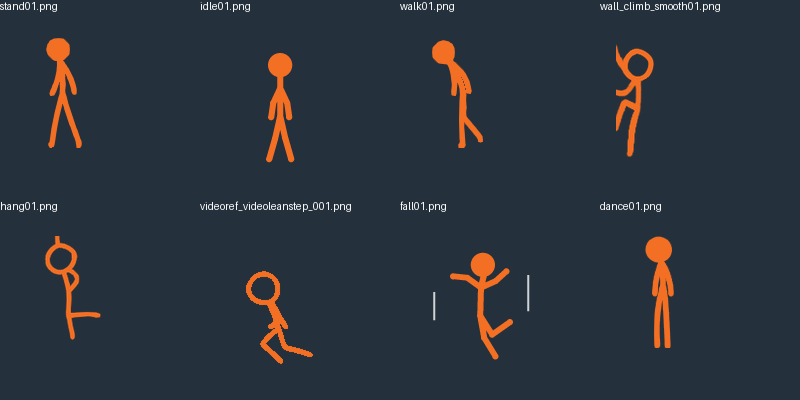
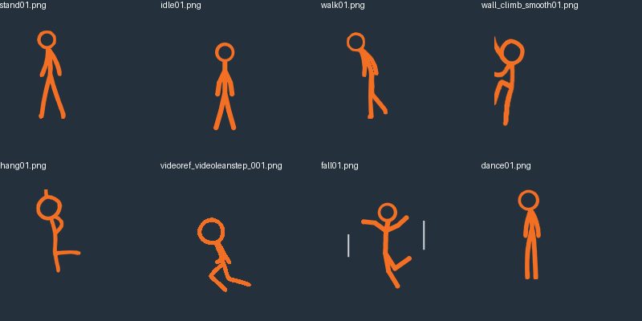

> Superseded in part by the [proportional redraw](proportions/README.md).
> The original 437-frame cutout pass described here was a head-fill-only fix.
> The current generator draws larger Orange rings directly; the remaining
> 151 legacy stock regions use the larger outline pass. Do not interpret the
> historical before/after pictures below as the current proportion repair.

# Consistent Orange head style

Orange's source climbing and video-derived actions already use a hollow head.
437 stock/procedural PNGs instead had filled heads. This repair cuts transparent
interiors in those images, preserving their existing outer head silhouettes,
body pixels, canvas size and XML anchors/timing. It does not standardize head
size or body proportions across different art families.





The sheet samples standing, idle, walking, wall climbing, ceiling hanging,
video-derived movement, falling and dancing. Both sheets were visually inspected
on a dark background. The contact sheet of the 437 candidate images was also
reviewed; this is asset review, not a live ShimeLinux test.

`tools/orange_head_regions.json` records image names, interior centers and the
original filled-head radius. Candidates were located using the largest inscribed
circle in the orange-color mask (minimum radius 8px). The manifest is fixed, not
an automatic runtime detector, so props cannot become new candidates on rerun.
Only interior alpha is reduced; no background color is painted into the hole.
The retained ring is approximately 3.5px thick. Existing hollow source artwork,
other characters and third-party baselines are not modified.

After importing or regenerating art, apply the idempotent final pass:

```sh
python tools/normalize_orange_heads.py
```

The procedural and stock-normalization generators also apply the same operation
when writing a listed Orange frame, so rerunning them does not restore filled
heads. New frame filenames must be reviewed and added to the manifest if needed.

Verification: 75 unittest tests pass, including all reviewed centers being
transparent, normalization idempotence, and preservation of exterior pixels and
RGB. Pack XML validation passes. No running desktop was available for testing.
