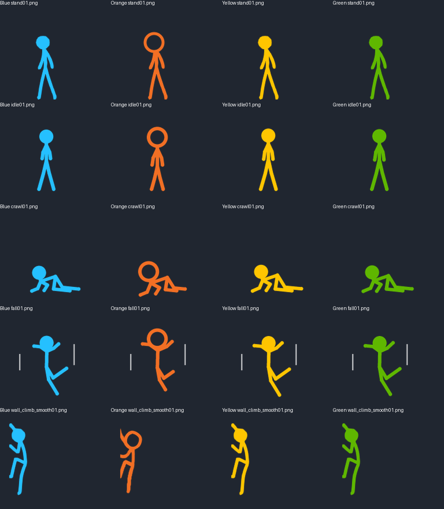
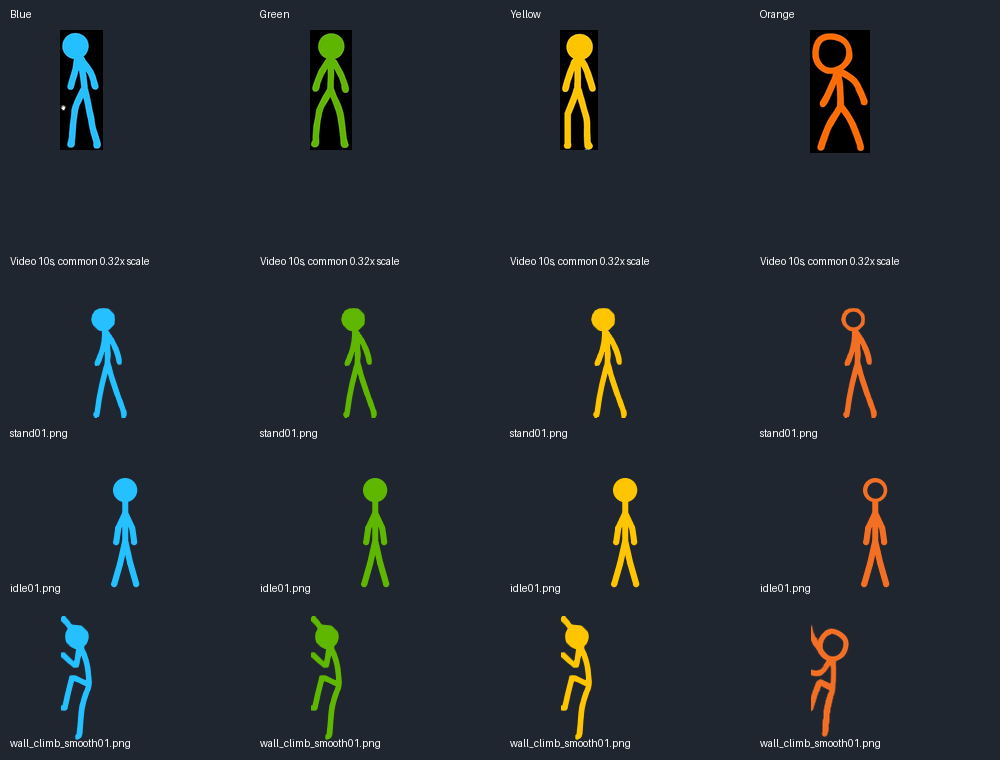

# Per-character master-frame checks

This revision replaces the shared-median render body plan with **four separate
profiles**. Each character has one fixed crop in `output.mp4` at 10.0s; the
annotated `*-reference-joints.png` files show those individual selections.
The same timestamp contains all four figures, but each has its own measured
head, shoulder, hip, elbow, hand, knee and foot. Points are approximate manual
2D centerline annotations. Orange's bent pose remains a limitation: a single
view is a style guide, not a guarantee of true 3D bone lengths.

`tools/character_reference.py` derives each profile from its OWN selected pose.
Scale is set by the head radius (12px for solid heads, 18px for Orange); torso,
upper arm, forearm, thigh and shin are measured independently, not copied from
a median and not estimated from pose bounding-box height. Rendered frames now
select their character's profile before drawing, including before rotations.
The common `PROPORTIONS` dictionary remains only a legacy authoring/default rig;
it is no longer the body plan used by all four render colors.

- Regenerated 1,050 procedural frame references with the individual targets.
- `character-targets.json` records the four selected crops and target lengths.
- `per-frame-check.csv` compares every procedural render-input skeleton to its
  own master. It includes every XML-referenced raster lacking joint data as
  **UNMEASURED**, never as passing.
- Currently measured: Blue 248, Green 264, Yellow 248, Orange 290 unique frames.
- Still unmeasured raster-only frames: Blue 245, Green 247, Yellow 246,
  Orange 309. These include stock, source climbing and video art. They need
  centerline annotation/review before a whole-pack proportion claim is valid.

These numeric checks concern render-input centerlines, not automatic recovery
of skeletons from PNGs. Pixel-level prop overlaps, occlusion and surface
contacts still need visual review. The regenerated family sheet was inspected;
its climbing row deliberately remains visible as an unresolved comparison.
No native ShimeLinux runtime capture is available here.

Reproduce:

```sh
python tools/stickgen.py
python tools/check_character_proportions.py
python tools/make_proportion_preview.py
```

The earlier pass and evidence checkpoint below are historical; their shared
ratio table is not the current per-character rendering target.

---

# First proportional redraw pass

Actual pack changes now follow the evidence checkpoint below:

- Regenerated 1,050 procedural frames across all four characters, with a
  14.7px head-center-to-shoulder chain (was 23), 26.9px torso, 27.6px total
  arm length and 51.8px total leg length. These are drawing-space dimensions;
  Orange now uses an 18px outer head radius versus 12px for the others.
- Preserve authored bone directions during retargeting. Previously directions
  were recomputed against already-moved parents, unintentionally changing
  the gesture as lengths changed.
- Retarget grounded feet before drawing so the longer legs do not sink through
  unchanged XML anchors. Adjust crawl shoulder height for the shorter reach.
- Enlarge Orange's 151 legacy stock head regions to the same 36px outer
  diameter and transparent interior. Two bounce-family head centers move up
  2px to avoid clipping the enlarged head at the canvas boundary.
- Generated Orange heads are drawn as rings before whole-body rotation, not
  erased afterwards using obsolete pixel coordinates. The legacy region
  manifest now covers stock art only.



[One-pass pose preview](redrawn-motion.gif) shows idle, crawl and falling;
this is not a desktop capture and does not integrate XML velocity. Render
with `python tools/make_proportion_preview.py`.

**Still unfinished:** imported climbing/video silhouettes remain original,
not retargeted; the source climbing row is included for honest comparison.
Legacy stock bodies are not reconstructed. Props and transitions still need
broader visual review; this is not a claim of all-video/all-character completion
or perfect proportions. The previous Orange head-fill-only preview is historical.
No XML timing, behavior weights, anchors or velocity values changed in this pass.

78 tests pass, including reference-ratio checks, rendered Orange head diameter
and transparent interior, and idle-floor placement. Pack validation passes.
Tests do not establish visual fidelity; static redraw sheets were also inspected.
No live ShimeLinux session is available here.

---

# Pre-redraw evidence checkpoint

This is an evidence checkpoint, **not a completed proportional redraw**. Existing
pack pixels have not been resized or warped in this checkpoint. The earlier
hollow-head change is still unmerged and is not a proportion solution.

## Reference and measurements

`tools/audit_reference_proportions.py` decodes `output.mp4` at 10 seconds and
renders all four currently installed characters using the SAME reference-shot
scale. Measurements use manually annotated approximate centerlines from
`tools/reference_proportions.json`; head sizes are outer diameters. Annotations
were made on a 1568x882 displayed image and converted to the decoded 1920x1080
source coordinates. Generated rig measurements are read from stickgen, not
estimated from a screenshot. Annotated crops and the family sheet were visually
inspected after correcting the display-to-source coordinate conversion.

| Ratio, in head diameters | Blue | Green | Yellow | pre-redraw generated rig |
|---|---:|---:|---:|---:|
| Head center to shoulder | .625 | .608 | .607 | .958 |
| Shoulder to hip | 1.126 | 1.121 | 1.121 | 1.167 |
| Upper arm + forearm | 1.021 | 1.156 | 1.151 | 1.279 |
| Thigh + shin | 2.113 | 2.159 | 2.207 | 1.850 |

These are approximate measurements from a title pose, not universal anatomical
constants. Blue's nearer arm is bent/foreshortened; do not blindly copy that
shorter measurement to every gesture. Orange leans with bent legs: its measured
leg/height ratios cannot be treated as an upright rest skeleton. Head center to
shoulder includes the portion covered by the head; it is not visible neck length.

### Concrete findings

- All generated characters share an overlong head-to-shoulder chain compared
  with this shot (about .96 head diameters versus .61).
- Their generated legs are relatively short (1.85 diameters versus 2.11–2.21).
- Orange is intentionally different: a large hollow head, about 1.5 times the
  other heads' outer diameter in the same shot. Normalizing Orange to the same
  24px head as everyone else was a design error, not fidelity to the video.
- Stock standing, generated idle and source climbing remain different body
  families. Fixing one family alone would keep the shape-change at transitions.



The video row uses a common 0.32x shot scale; pack rows retain native pixels.
This is a ratio/style comparison, not a frame-by-frame animation comparison.
Bent climbing silhouettes must not be scaled by their bounding-box height to
match an upright standing silhouette.

## Remaining implementation

Review action-shot centerlines (not just this lineup), define character-specific
rest skeletons, then retarget the affected art families with pose/prop/contact
review. Keep anchors, integer velocities and action timing separate from art
changes. Recheck walking-to-idle, throw-to-fall, wall grip and ceiling contact
in motion. Whole-video animation extraction and Red remain separate unfinished
scope; the overview samples do not establish completion of either.

Reproduce the checkpoint with Pillow, NumPy and OpenCV installed:

```sh
python tools/audit_reference_proportions.py
```
